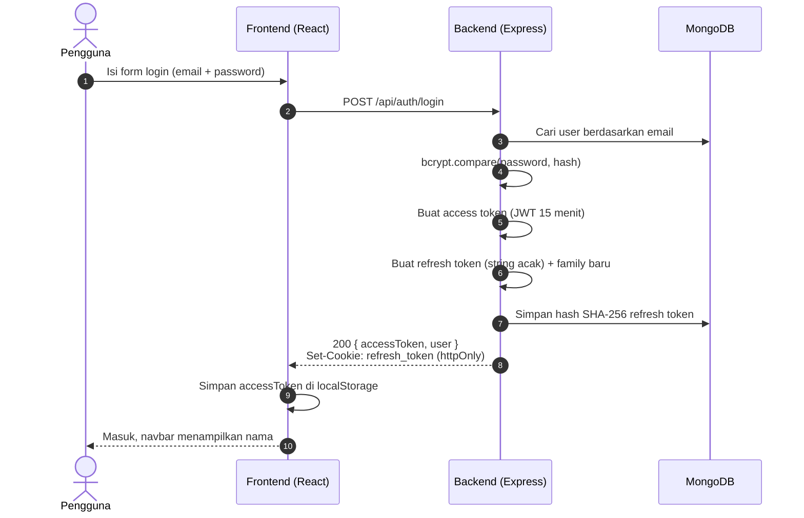
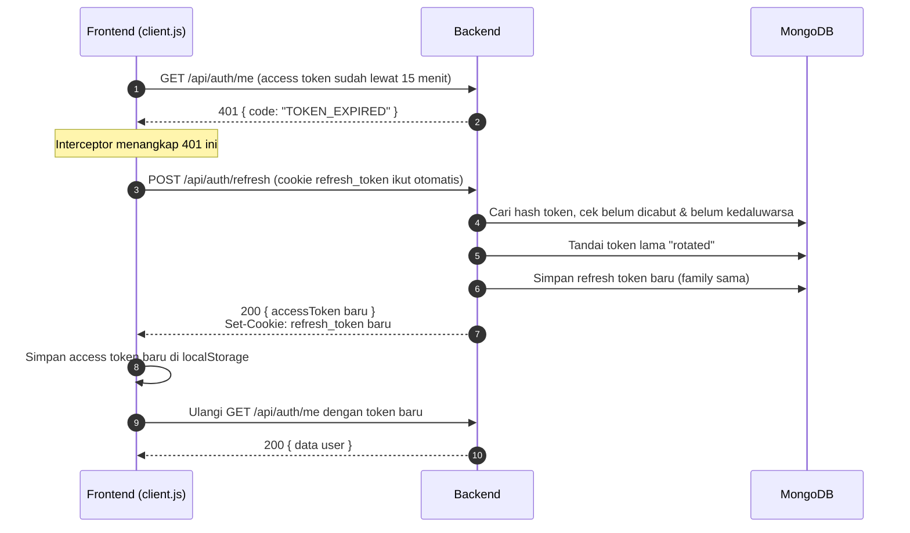
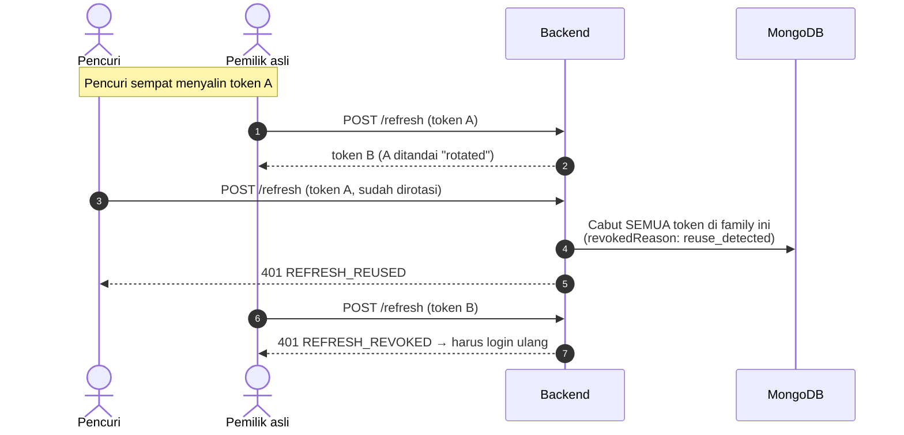

# Autentikasi: JWT + Refresh Token

Dokumen ini menjelaskan cara kerja login di TokoKita, mulai dari registrasi sampai mekanisme
refresh token yang membuat pengguna tetap login tanpa harus memasukkan password berulang kali.

## Daftar isi

1. [Gambaran singkat](#1-gambaran-singkat)
2. [Kenapa butuh dua token?](#2-kenapa-butuh-dua-token)
3. [Peran pengguna (role)](#3-peran-pengguna-role)
4. [Alur lengkap](#4-alur-lengkap)
5. [Rotasi dan deteksi pencurian token](#5-rotasi-dan-deteksi-pencurian-token)
6. [Logout](#6-logout)
7. [Penyimpanan di database](#7-penyimpanan-di-database)
8. [Implementasi di frontend](#8-implementasi-di-frontend)
9. [Daftar endpoint dan kode error](#9-daftar-endpoint-dan-kode-error)
10. [Keamanan dan batasannya](#10-keamanan-dan-batasannya)
11. [Cara menguji](#11-cara-menguji)

---

## 1. Gambaran singkat

| | Access token | Refresh token |
| --- | --- | --- |
| Bentuk | JWT (ditandatangani `JWT_SECRET`, algoritma HS256) | String acak 64 karakter (bukan JWT) |
| Umur | **15 menit** (`ACCESS_TOKEN_EXPIRES_IN`) | **7 hari** (`REFRESH_TOKEN_EXPIRES_DAYS`) |
| Batas sesi | - | Maksimal **30 hari** sejak login (`SESSION_MAX_DAYS`), walaupun terus dirotasi |
| Disimpan di browser | `localStorage` (`tokokita_access_token`) | Cookie `refresh_token` (httpOnly) |
| Dikirim lewat | Header `Authorization: Bearer <token>` | Otomatis oleh browser, hanya ke `/api/auth/*` |
| Disimpan di server | Tidak (cukup diverifikasi tanda tangannya) | Ya, hash SHA-256-nya di koleksi `refreshtokens` |
| Bisa dicabut sebelum habis? | Tidak, tunggu kedaluwarsa (maks. 15 menit) | Ya, kapan saja |
| Dipakai untuk | Semua request yang butuh login | Hanya untuk meminta access token baru |

File yang terlibat:

| Bagian | File |
| --- | --- |
| Model akun & sesi | `backend/src/models/User.js`, `backend/src/models/RefreshToken.js` |
| Logika token (buat, rotasi, cabut) | `backend/src/services/tokenService.js` |
| Endpoint auth & cookie | `backend/src/controllers/authController.js`, `backend/src/routes/authRoutes.js` |
| Cek token & role di setiap request | `backend/src/middleware/auth.js` (`requireAuth`, `requireAdmin`) |
| Refresh otomatis di browser | `frontend/src/api/client.js` |
| Status login di React | `frontend/src/context/AuthContext.jsx` |
| Proteksi halaman | `frontend/src/components/ProtectedRoute.jsx` |

## 2. Kenapa butuh dua token?

Kalau cuma pakai satu JWT, kita terjebak di antara dua pilihan yang sama-sama tidak enak:

- **Umurnya panjang** (misalnya 7 hari): nyaman, tapi kalau token dicuri, pencurinya bebas memakai akun
  selama 7 hari. JWT juga tidak bisa "dibatalkan" karena server tidak menyimpannya.
- **Umurnya pendek** (misalnya 15 menit): aman, tapi pengguna harus login ulang setiap 15 menit.

Solusinya dipecah dua:

- **Access token** berumur pendek dan dipakai di setiap request. Kalau bocor, kerusakannya terbatas karena
  sebentar lagi kedaluwarsa.
- **Refresh token** berumur panjang, tapi hanya dipakai untuk satu hal: menukar access token baru. Token ini
  disimpan di cookie httpOnly yang **tidak bisa dibaca JavaScript**, dan tercatat di database sehingga bisa
  dicabut kapan saja.

Ketentuan tugas meminta JWT disimpan di `localStorage`. Itu dipenuhi oleh access token. Karena
`localStorage` bisa dibaca script mana pun di halaman (rawan XSS), umurnya sengaja dibuat pendek. Refresh
token yang lebih berharga disimpan di tempat yang lebih aman.

## 3. Peran pengguna (role)

| Role | Cara dapat | Boleh apa |
| --- | --- | --- |
| Tamu | Tidak login | Lihat beranda, daftar produk, detail produk |
| `user` | Daftar lewat halaman `/daftar` | Semua yang tamu bisa + halaman **Akun Saya** (`/akun`) |
| `admin` | Hanya lewat `npm run seed` / `npm run seed:admin` | Semua yang user bisa + **tambah, ubah, hapus produk** |

Field `role` di body registrasi sengaja diabaikan, jadi tidak ada yang bisa mendaftar sebagai admin.
Role dibaca dari database di setiap request (bukan dari isi token), jadi kalau role seseorang diubah,
efeknya langsung terasa.

Proteksinya berlapis:

| Lapisan | Contoh | Fungsi |
| --- | --- | --- |
| Frontend: `ProtectedRoute` | `/akun` minta login, `/produk/tambah` minta admin | Kenyamanan: arahkan ke login atau tampilkan 403 |
| Frontend: tombol | Tombol Edit/Hapus disembunyikan dari non-admin | Kenyamanan tampilan |
| **Backend: middleware** | `requireAuth` + `requireAdmin` di POST/PUT/DELETE produk | **Keamanan sebenarnya.** API tetap menolak walau dipanggil langsung lewat curl/Postman |

## 4. Alur lengkap

### 4.1 Registrasi dan login



Registrasi (`POST /api/auth/register`) alurnya sama persis, bedanya akun dibuat dulu (role `user`,
password di-hash bcrypt) dan statusnya `201`.

### 4.2 Request biasa

Setiap request ke API, interceptor Axios menempelkan header `Authorization: Bearer <access token>`.
Middleware `requireAuth` memverifikasi tanda tangan dan masa berlaku JWT, lalu mengambil data user terbaru
dari database.

### 4.3 Access token kedaluwarsa → refresh otomatis

Ini terjadi di belakang layar. Pengguna tidak melihat apa-apa selain halaman yang tetap jalan normal.



Kalau refresh juga gagal (refresh token sudah habis atau dicabut), sesi benar-benar berakhir. Frontend
menghapus token, mengosongkan status login, dan halaman login menampilkan pesan dari server, misalnya
*"Sesi login kamu sudah diakhiri, silakan login lagi"*.

### 4.4 Membuka aplikasi lagi (misalnya besok)

Saat aplikasi dibuka dan ada access token di `localStorage`, `AuthContext` memanggil `GET /api/auth/me`.
Access token-nya sudah pasti kedaluwarsa, jadi alur 4.3 berjalan otomatis. Selama refresh token masih
berlaku (7 hari sejak terakhir dipakai), pengguna langsung masuk tanpa mengetik password.

## 5. Rotasi dan deteksi pencurian token

### Rotasi

Setiap kali refresh token dipakai, token itu **langsung dinonaktifkan** dan diganti token baru. Semua token
hasil rotasi dari satu kali login berbagi satu **family** (UUID yang dibuat saat login).

```
login ──► token A ──refresh──► token B ──refresh──► token C   (family: 7f3e...)
          rotated              rotated              aktif
```

Masa berlakunya bergeser (sliding): setiap token baru berlaku 7 hari sejak diterbitkan. Jadi pengguna tidak
perlu login ulang selama masih membuka aplikasi minimal seminggu sekali.

Tapi ada **batas mutlak 30 hari sejak login** (`sessionExpiresAt`). Batas ini diwariskan ke setiap token
hasil rotasi, dan umur token tidak boleh melewatinya. Setelah 30 hari, pengguna wajib login ulang walaupun
aktif terus. Tanpa batas ini, sesi yang dicuri, atau perangkat yang tertinggal dalam keadaan login, bisa
hidup selamanya.

```
login 1 Okt ─► token A (s/d 8 Okt) ─► token B (s/d 15 Okt) ─► ... ─► token terakhir (s/d 31 Okt, dipotong)
               batas sesi untuk semua token di family ini: 31 Okt ──────────────────────────┘
```

### Deteksi pemakaian ulang (reuse detection)

Browser pemilik asli selalu memegang token **terbaru**. Jadi kalau ada yang memakai token yang **sudah
dirotasi**, hampir pasti itu salinan curian.



Pemilik asli memang ikut dipaksa login ulang. Itu disengaja: server tidak bisa membedakan mana yang asli,
jadi yang paling aman adalah mematikan semuanya. Pencuri tidak tahu passwordnya, jadi dia tidak bisa masuk lagi.

### Masa toleransi 10 detik

Ada satu kasus wajar yang terlihat seperti pencurian: **dua tab** (atau dua request) melakukan refresh
hampir bersamaan dengan cookie yang sama. Request pertama merotasi token, request kedua datang membawa
token yang baru saja dirotasi.

Untuk itu ada `REUSE_GRACE_MS = 10 detik` di `tokenService.js`. Kalau token lama dipakai lagi **kurang
dari 10 detik** setelah dirotasi, server tidak menganggapnya pencurian. Server cukup memberi access token
baru tanpa merotasi lagi, karena cookie di browser sudah berisi token terbaru dari request pertama.

Selain itu, `findOneAndUpdate({ _id, revokedAt: null })` memastikan hanya satu request yang berhasil
merotasi sebuah token, jadi tidak pernah ada dua token "anak" dari satu token yang sama.

### Ringkasan keputusan di `/api/auth/refresh`

| Kondisi token di database | Hasil | Kode |
| --- | --- | --- |
| Tidak ada cookie | 401 | `NO_REFRESH_TOKEN` |
| Hash tidak ditemukan | 401 | `REFRESH_INVALID` |
| Dicabut karena logout / logout semua / pencurian | 401 | `REFRESH_REVOKED` |
| Sudah dirotasi, dipakai lagi **< 10 detik** | 200, access token baru saja | |
| Sudah dirotasi, dipakai lagi **≥ 10 detik** | 401 + cabut seluruh family | `REFRESH_REUSED` |
| Lewat `expiresAt` (7 hari tidak dipakai, atau batas sesi 30 hari tercapai) | 401 | `REFRESH_EXPIRED` |
| Aktif dan masih berlaku | 200, access token + refresh token baru (rotasi) | |

## 6. Logout

| Aksi | Endpoint | Efek |
| --- | --- | --- |
| Keluar | `POST /api/auth/logout` | Refresh token perangkat ini dicabut (`logout`), cookie dihapus, `localStorage` dibersihkan |
| Keluar dari semua perangkat | `POST /api/auth/logout-all` | **Semua** refresh token milik akun dicabut (`logout_all`) |

Catatan untuk "keluar dari semua perangkat": access token di perangkat lain tetap berlaku sampai
kedaluwarsa (maksimal 15 menit), karena access token tidak dicek ke database. Setelah itu, refresh mereka
ditolak dan mereka harus login ulang. Inilah alasan access token dibuat pendek.

Status login juga disinkronkan **antar-tab** lewat event `storage`. Logout di satu tab membuat tab lain di
browser yang sama ikut berstatus tamu.

## 7. Penyimpanan di database

Koleksi `users`:

```js
{ name, email (unik, huruf kecil), password (hash bcrypt), role: 'user' | 'admin', createdAt, updatedAt }
```

Koleksi `refreshtokens`:

```js
{
  user:          ObjectId,      // pemilik token
  tokenHash:     String,        // SHA-256 dari token asli (token asli tidak pernah disimpan)
  family:        String,        // UUID, sama untuk semua token hasil rotasi dari satu login
  expiresAt:     Date,          // 7 hari sejak diterbitkan, tidak melewati sessionExpiresAt.
                                //   + TTL index: MongoDB menghapus dokumen otomatis setelah lewat
  sessionExpiresAt: Date,       // batas mutlak sesi (30 hari sejak login), sama untuk satu family
  revokedAt:     Date | null,   // null = masih aktif
  revokedReason: 'rotated' | 'logout' | 'logout_all' | 'reuse_detected',
  userAgent:     String,        // info browser, untuk keperluan audit
  createdAt, updatedAt
}
```

Kenapa refresh token di-hash? Kalau database bocor, isinya tidak bisa langsung dipakai untuk login. Yang
dipakai SHA-256 (bukan bcrypt) karena token-nya sudah acak 384 bit, jadi tidak bisa ditebak dengan
brute-force, dan pencariannya perlu cepat.

Cek isinya lewat terminal:

```bash
docker exec -it toko-online-mongo mongosh toko_online --eval '
  db.refreshtokens.aggregate([{ $group: { _id: "$revokedReason", jumlah: { $sum: 1 } } }])'
```

## 8. Implementasi di frontend

### `client.js`: interceptor Axios

1. **Request interceptor** menempelkan `Authorization: Bearer <token dari localStorage>`.
2. **Response interceptor**: kalau balasan `401` dengan `code` `TOKEN_EXPIRED` atau `TOKEN_INVALID`:
   - panggil `POST /api/auth/refresh`,
   - simpan access token baru,
   - **ulangi request yang tadi gagal** (maksimal sekali, ditandai `_retried`).
3. **Single-flight refresh**: kalau ada beberapa request gagal bersamaan, semuanya menunggu **satu**
   promise refresh yang sama (`refreshPromise`). Refresh token tidak dirotasi berkali-kali.
4. Kalau refresh ditolak `401`, handler `onSessionExpired` di `AuthContext` dipanggil. Kalau gagal karena
   hal lain (misalnya server mati), pengguna **tidak** dipaksa logout.

### Kenapa API dipanggil lewat `/api`, bukan langsung ke domain backend?

Cookie refresh token memakai `SameSite=Strict`, artinya hanya dikirim kalau request berasal dari situs yang
sama. Karena itu frontend selalu memanggil `/api/...` di domainnya sendiri, lalu request itu diteruskan:

- **Lokal**: proxy Vite (`frontend/vite.config.js`) → `http://localhost:5000`
- **Production**: rewrite Vercel (`frontend/vercel.json`) atau Netlify (`frontend/netlify.toml`) → URL Render

Bagi browser, semuanya terlihat satu domain. Cookie aman dipakai, dan tidak perlu konfigurasi CORS.

## 9. Daftar endpoint dan kode error

| Method | Endpoint | Butuh | Keterangan |
| --- | --- | --- | --- |
| POST | `/api/auth/register` | - | `{ name, email, password }` → `201 { accessToken, user }` + cookie. Maks. 10x / jam per IP |
| POST | `/api/auth/login` | - | `{ email, password }` → `200 { accessToken, user }` + cookie. Maks. 5x gagal / 15 menit per email |
| POST | `/api/auth/refresh` | cookie | → `200 { accessToken, user }` + cookie baru |
| POST | `/api/auth/logout` | cookie | Cabut refresh token perangkat ini |
| POST | `/api/auth/logout-all` | access token | Cabut semua refresh token akun ini |
| GET | `/api/auth/me` | access token | Data akun + `activeSessions` |

Semua error berbentuk `{ code, message }`:

| Status | `code` | Arti |
| --- | --- | --- |
| 400 | `VALIDATION_ERROR` | Data tidak valid (ada `errors[]` berisi detailnya) |
| 401 | `INVALID_CREDENTIALS` | Email atau password salah |
| 401 | `NO_TOKEN` | Tidak mengirim access token |
| 401 | `TOKEN_EXPIRED` | Access token kedaluwarsa → **frontend otomatis refresh** |
| 401 | `TOKEN_INVALID` | Access token rusak/palsu → frontend coba refresh |
| 401 | `NO_REFRESH_TOKEN`, `REFRESH_INVALID`, `REFRESH_EXPIRED`, `REFRESH_REVOKED`, `REFRESH_REUSED` | Sesi berakhir, harus login ulang |
| 403 | `FORBIDDEN` | Sudah login tapi bukan admin |
| 409 | `EMAIL_TAKEN` | Email sudah terdaftar |
| 429 | `TOO_MANY_ATTEMPTS` | Terlalu banyak login gagal untuk email itu |
| 429 | `TOO_MANY_REGISTRATIONS` | Terlalu banyak pendaftaran dari IP yang sama |

## 10. Keamanan dan batasannya

### Yang sudah ditangani

**Password dan login**
- Password di-hash **bcrypt** (cost 10), minimal 8 dan maksimal 72 karakter (batas bcrypt).
- Pesan login gagal selalu sama (*"Email atau password salah"*). **Waktu responsnya juga sama** (±70 ms):
  kalau email tidak terdaftar, server tetap menjalankan bcrypt terhadap hash palsu. Tanpa ini, email yang
  tidak terdaftar dibalas sekitar 15 kali lebih cepat, dan dari selisih itu orang bisa menebak email mana yang punya akun.
- Input login dipaksa jadi string untuk mencegah **NoSQL injection** (`{"$ne": null}`).
- Field `role` di registrasi diabaikan, jadi tidak ada yang bisa mendaftar sebagai admin.

**Token dan sesi**
- JWT dikunci ke algoritma **HS256**, jadi token palsu dengan `alg: none` ditolak.
- Refresh token di cookie **httpOnly** (tidak bisa dicuri lewat XSS), **SameSite=Strict** (tidak ikut
  terkirim dari situs lain/CSRF), **Secure** di production (hanya HTTPS), dan **Path=/api/auth** (tidak ikut
  terkirim ke endpoint lain).
- Refresh token **dirotasi**, **di-hash** di database, dan pemakaian ulangnya **terdeteksi**.
- Sesi punya **batas mutlak 30 hari** sejak login.
- Server menolak jalan kalau `JWT_SECRET` belum diisi.

**Pembatasan (rate limit)**
- Login: maksimal **5 kali gagal per email** dalam 15 menit.
- Registrasi: maksimal **10 percobaan per IP** per jam. Percobaan yang gagal ikut dihitung, jadi halaman
  daftar juga tidak bisa dipakai untuk mengecek ribuan email sekaligus.

**Header keamanan**

| Header | Frontend (`vercel.json` / `netlify.toml`) | Backend (`helmet`) | Fungsinya |
| --- | --- | --- | --- |
| `Content-Security-Policy` | Hanya script dari domain sendiri, Google Analytics, dan LogRocket | `default-src 'self'` (API cuma mengirim JSON) | Script sisipan penyerang (XSS) ditolak browser, jadi access token di `localStorage` jauh lebih sulit dicuri |
| `X-Frame-Options` + `frame-ancestors` | `DENY` / `'none'` | `SAMEORIGIN` / `'self'` | **Anti-clickjacking**: situs lain tidak bisa menyisipkan TokoKita di iframe tersembunyi untuk menipu klik |
| `X-Content-Type-Options` | `nosniff` | `nosniff` | Browser tidak menebak-nebak tipe file, jadi file teks tidak bisa dijalankan sebagai script |
| `Referrer-Policy` | `strict-origin-when-cross-origin` | `no-referrer` | Alamat lengkap halaman tidak bocor ke situs lain |
| `Permissions-Policy` | Kamera, mikrofon, lokasi, dan pembayaran dimatikan | - | Fitur browser yang tidak dipakai tidak bisa disalahgunakan |
| `Strict-Transport-Security` | Otomatis dari Vercel/Netlify | 1 tahun | Memaksa browser selalu memakai HTTPS |

Header backend dipasang oleh [`helmet`](https://helmetjs.github.io/) di `server.js`.

Kalau nanti menambah script atau layanan pihak ketiga lain (misalnya widget chat), domainnya **harus
ditambahkan ke CSP** di `vercel.json` dan `netlify.toml`. Kalau tidak, browser akan memblokirnya. Domain
LogRocket di CSP diambil langsung dari kode library-nya. LogRocket juga membuat Web Worker dari `blob:`,
makanya ada `worker-src blob:`.

### Batasan yang perlu diketahui

- Access token di `localStorage` tetap bisa dibaca kalau ada celah XSS. Risikonya ditekan dua lapis: CSP
  (script asing tidak bisa jalan) dan umur token yang hanya 15 menit.
- "Keluar dari semua perangkat" baru berlaku penuh setelah access token di perangkat lain kedaluwarsa (≤ 15 menit).
- Hitungan rate limit disimpan di memori server. Kalau server restart (misalnya Render tidur), hitungannya ter-reset.
- Rate limit login per email bisa disalahgunakan untuk mengunci akun orang lain selama 15 menit dengan
  sengaja salah password.
- Rate limit registrasi memakai IP. Pengguna di satu jaringan (misalnya Wi-Fi kampus) berbagi kuota yang
  sama. Orang yang memanggil server Render secara langsung (tidak lewat Vercel) bisa memalsukan IP lewat header.
- Halaman daftar tetap memberi tahu kalau email sudah terdaftar. Ini pilihan demi kenyamanan pengguna,
  dan dibatasi oleh rate limit registrasi.
- Belum ada verifikasi email dan fitur lupa password.

## 11. Cara menguji

Batas sesi 30 hari bisa dicoba dengan nilai kecil, misalnya `SESSION_MAX_DAYS=0.0002` (±17 detik). Login,
tunggu 17 detik, lalu pindah halaman: kamu akan diminta login ulang dengan pesan *"sesi login dibatasi ..."*.

Untuk melihat refresh token biasa bekerja:

Cara paling cepat melihat refresh token bekerja adalah memperpendek umur access token:

```bash
cd backend
ACCESS_TOKEN_EXPIRES_IN=20s npm run dev
```

Lalu di browser:

1. Login, buka **DevTools → Application → Local Storage**, catat isi `tokokita_access_token`.
2. Buka **Application → Cookies**. Ada `refresh_token` dengan centang **HttpOnly**.
3. Tunggu 20 detik, lalu pindah halaman ke **Akun Saya**.
4. Di tab **Network** terlihat urutan: `me` (401) → `refresh` (200) → `me` (200). Isi local storage berganti.

Lewat terminal:

```bash
# Login, simpan cookie ke file cookies.txt
curl -c cookies.txt -X POST http://localhost:5000/api/auth/login \
  -H "Content-Type: application/json" \
  -d '{"email":"admin@example.com","password":"PASSWORD_ADMIN"}'

# Minta access token baru pakai refresh token di cookie (cookie ikut dirotasi)
curl -b cookies.txt -c cookies.txt -X POST http://localhost:5000/api/auth/refresh

# Logout: refresh token dicabut di server
curl -b cookies.txt -c cookies.txt -X POST http://localhost:5000/api/auth/logout
```
